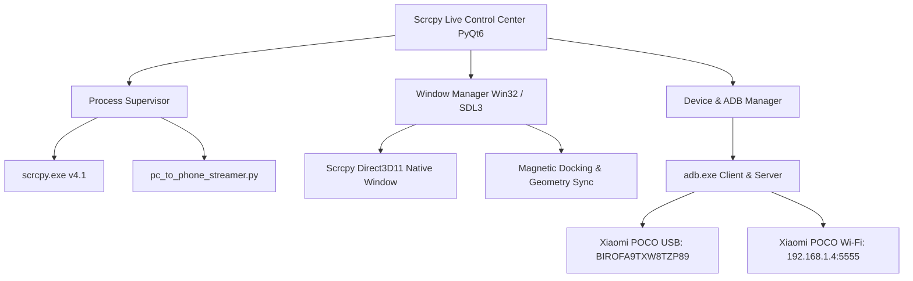

# Technical Implementation Plan: Scrcpy Live Control Center

**Feature ID**: 001-scrcpy-live-control-center  
**Status**: Ready for Implementation  

---

## 1. System Architecture

---

## 2. Component Design

### Component A: Process Supervisor (`ProcessSupervisor`)
- **Responsibility**: Guarantees zero zombie/orphaned processes.
- **Rules**:
  1. Before launching any new session, scan and terminate any running `scrcpy.exe` processes belonging to the script directory.
  2. Maintain a single source of truth for the active child process (`Popen`).
  3. Register an `atexit` handler and handle `closeEvent` to terminate children cleanly and remove reverse tunnels (`adb reverse --remove tcp:8765`).

### Component B: Window Manager (`WindowManager`)
- **Responsibility**: Manages the visual presence of the live phone screen.
- **Architectural Approach**:
  1. **Magnetic Docked Mode (Default)**:
     - Scrcpy is launched with `--window-borderless --window-title=ScrcpyLiveScreen`.
     - When Scrcpy's window is created, the Window Manager docks it seamlessly to the left side of the Control Center, synchronized pixel-for-pixel with the Control Center's position and height.
     - When the user drags, moves, snaps, or resizes the Control Center, Scrcpy follows seamlessly as one unified multi-pane application.
  2. **Embedded Container Mode**:
     - Supports embedding via `SetParent` with proper window styles (`WS_CHILD | WS_VISIBLE`), while maintaining a failsafe fallback to Docked Mode if reparenting fails or SDL3 disconnects.
  3. **Pop-Out Floating Mode**:
     - With one click on `🗖 Pop Out`, Scrcpy is freed to float independently anywhere on the desktop. Clicking `🗔 Re-Dock` snaps it right back into the docked cockpit!

### Component C: Device & ADB Manager (`DeviceManager`)
- **Responsibility**: Robust device detection, battery telemetry, and wake pipeline.
- **Rules**:
  1. Always pass `-s <serial>` to prevent "multiple devices" collisions.
  2. Implement dual-pipeline wake:
     - ADB safe intent: `am start -a android.intent.action.MAIN -c android.intent.category.HOME`
     - Statusbar wake: `cmd statusbar expand-notifications` -> `cmd statusbar collapse`
     - Dismiss keyguard: `wm dismiss-keyguard`
     - Scrcpy keyboard shortcut: `Alt+P` and `Alt+Shift+O`
  3. Never use commands that trigger `INJECT_EVENTS` or `WRITE_SECURE_SETTINGS`.

### Component D: GUI & Control Rail (`ControlCenterGUI`)
- **Top Cockpit**:
  - App header, live device specs, battery indicator, Wi-Fi IP.
  - ☀️ Day / 🌙 Night toggle button.
  - 📐 Snap Layout menu (Left 50%, Right 50%, Compact Side Dock, Center 75%, Maximize).
  - Text zoom buttons (`A-`, `A+`, zoom %).
  - Device combo selector + 1-Click Wi-Fi Connect button.
- **Hero Screen Area**:
  - Live mirror display frame.
  - Power status indicator (`💡 Phone Display: ON` vs `🔋 Phone Display: OFF (Saving Battery)`).
  - Quick Navigation Bar: `⚡ Screen OFF`, `💡 Screen ON`, `🔓 Wake Screen`, `🔙 Back`, `🏠 Home`, `🔲 Recents`, `🔔 Notifs`, `🔉 Vol-`, `🔊 Vol+`, `📸 Snap Screenshot`.
- **Right Control Rail**:
  - **Tab 1: 🎮 Shift Mode**: 1-Click buttons for Full Control, Screen-Off Saver, View-Only, Webcam, PC Assistant Stream, Record MP4, Audio Only.
  - **Tab 2: ⚙️ Stream Quality**: Resolution, Bitrate, FPS, Codec, Camera Sensor & 30 FPS selector.
  - **Tab 3: 📶 Connectivity**: 1-Click Wi-Fi Pairing, Disconnect Wi-Fi, Drag & Drop APK/Files, Maintenance.
  - **Tab 4: 📖 Xiaomi & Keys**: Lock screen `FLAG_SECURE` explanation, Stay Awake tip, Shortcut reference.
- **Footer**:
  - Live command preview + 📋 Copy button.
  - Status text.
  - ⏹️ Stop Active Session button.
